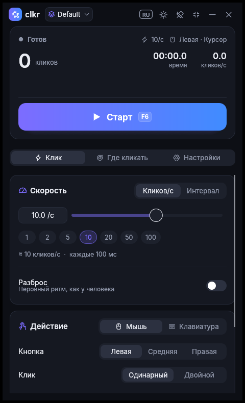
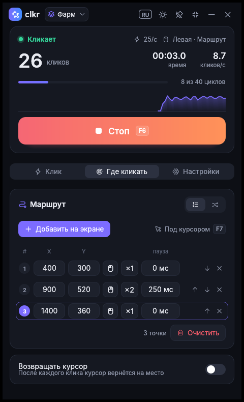
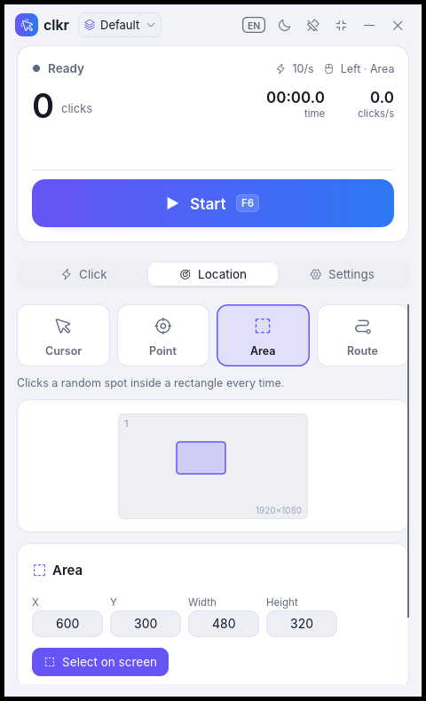
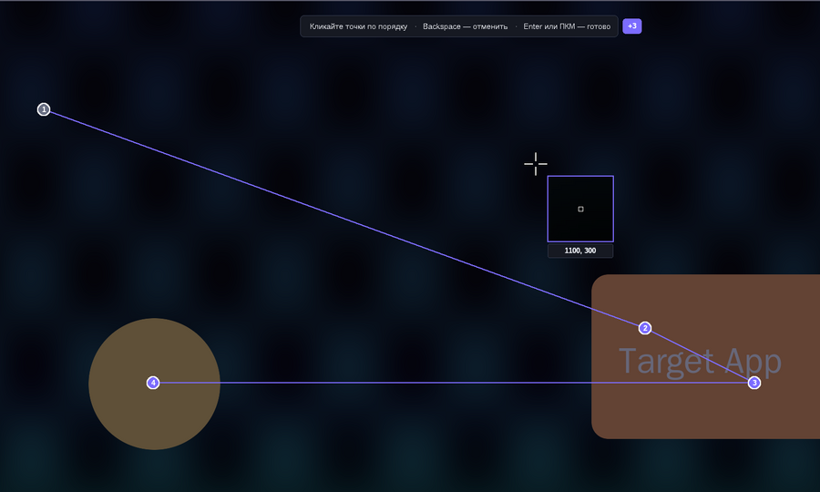
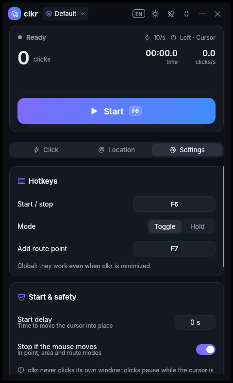
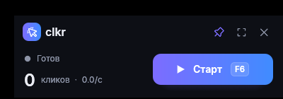

<p align="center">
  
</p>

<h1 align="center">clkr</h1>

<p align="center">
  A lightweight, good-looking auto clicker for Windows.<br>
  One portable <code>.exe</code> (~4 MB), no installer, no runtime, interface in English and Russian.
</p>

<p align="center">
  
  
  
</p>

## Features

**Speed**
- Clicks per second (0.01 – 1000) with a slider and presets, or an exact interval in h / min / s / ms.
- Optional random jitter (±1–50 %) for irregular, human-like timing.
- Precise timer: absolute deadlines (no drift), 1 ms system timer resolution while running,
  sleep + spin for the last couple of milliseconds.

**Action**
- Left / middle / right mouse button, single or double click.
- Keyboard mode: presses any key, optionally with Ctrl / Shift / Alt.
  Keys are sent as scan codes, which many games require.
- Adjustable hold time (how long the button or key stays down).

**Location**
- **Cursor**: clicks wherever the cursor is.
- **Point**: always the same spot.
- **Area**: a random spot inside a rectangle on every click.
- **Route**: a list of points clicked in order (or randomly), each with its own button,
  single/double click and extra pause.
- Pick points and areas **on screen**: a full-screen overlay shows a frozen, dimmed screenshot with a pixel
  loupe and live coordinates. Arrow keys nudge the cursor by 1 px (Shift: 10 px).
- Mini-map of all monitors with the current target(s), correct on multi-monitor and mixed-DPI setups.
- Optionally return the cursor to where it was after every click.

<p align="center"></p>

**Stop condition**: never, after N clicks (N cycles for a route), or after a time limit; progress is shown live.

**Hotkeys** (global, work while minimized)
- Start / stop (default <kbd>F6</kbd>) in *toggle* or *hold-to-click* mode.
- Add the point under the cursor to the route (default <kbd>F7</kbd>).
- Any key or combination, including mouse side buttons.

**Safety**
- clkr never clicks its own window: clicks pause while the cursor is over it, key presses pause while it is focused.
- Failsafe: stops when you move the mouse away from where clkr put it (point, area and route modes).
- Start delay to get the cursor into place.

**Comfort**
- Profiles: create, duplicate, rename, delete; every change is saved automatically.
- Compact mode and always-on-top.
- Dark and light themes, English and Russian interface (follows the system language on first run).
- Live statistics: clicks, elapsed time, real clicks per second with a small graph, lifetime total.

<p align="center">
  
  
</p>

## Download

Every push builds `clkr.exe` with GitHub Actions; grab it from the run's **Artifacts**
(*Actions → Build → clkr-windows-x64*). Pushing a tag like `v1.0.0` also attaches the exe to a GitHub Release.

The exe is not code-signed, so Windows SmartScreen may ask for confirmation on the first start
(*More info → Run anyway*). Some antivirus products flag auto clickers in general because they synthesize input.

Requirements: Windows 10 or 11, 64-bit, with OpenGL 2.0 or newer (any GPU driver from the last decade;
virtual machines without graphics acceleration may not provide it).

## Usage

1. Set the speed and the action on the **Click** tab.
2. Choose where to click on the **Location** tab, and pick the point, area or route on screen if needed.
3. Press <kbd>F6</kbd> (or the big button) to start and again to stop.

Settings are stored in `%APPDATA%\clkr\clkr.json`. For a portable setup, put an (even empty) `clkr.json`
next to `clkr.exe`; clkr will then keep its settings there.

## Building

Install [Rust](https://rustup.rs) (stable, 1.95 or newer).

On Windows:

```sh
cargo build --release
# -> target\release\clkr.exe
```

Cross-compiling from Linux (needs `gcc-mingw-w64-x86-64`):

```sh
rustup target add x86_64-pc-windows-gnu
cargo build --release --target x86_64-pc-windows-gnu
# -> target/x86_64-pc-windows-gnu/release/clkr.exe
```

`cargo run` also works on Linux/macOS for UI development: an inert backend is used there, so nothing is
actually clicked.

Checks used by CI: `cargo fmt --check`, `cargo clippy -- -D warnings`, `cargo test`.

## How it works

| Module | Purpose |
| --- | --- |
| `src/engine.rs` | Click engine thread with precise timing, live stats and a thread-safe `Controller` |
| `src/hotkeys.rs` | Polling global hotkeys (toggle / hold) and key capture |
| `src/platform/win.rs` | Win32 input (`SendInput`), cursor, monitors, DPI, fonts |
| `src/platform/picker_win.rs` | Full-screen GDI overlay for picking points, areas and routes |
| `src/settings.rs` | Settings, profiles and the JSON config file |
| `src/i18n.rs` | English and Russian strings (a missing translation is a compile error) |
| `src/ui/` | Theme, custom widgets and the screens (egui) |

The UI is built with [egui](https://github.com/emilk/egui) on the OpenGL backend and uses the system Segoe UI
font, which keeps the binary small. Icons are a 14 KB subset of [Phosphor Icons](https://phosphoricons.com);
regenerate it with `tools/subset_icons.py` after adding an icon to `src/ui/icons.rs`.
The app icon is rendered by `tools/make_icon.py`.

## License

[MIT](LICENSE). Phosphor Icons are MIT-licensed as well, see [assets/PHOSPHOR-LICENSE.txt](assets/PHOSPHOR-LICENSE.txt).
